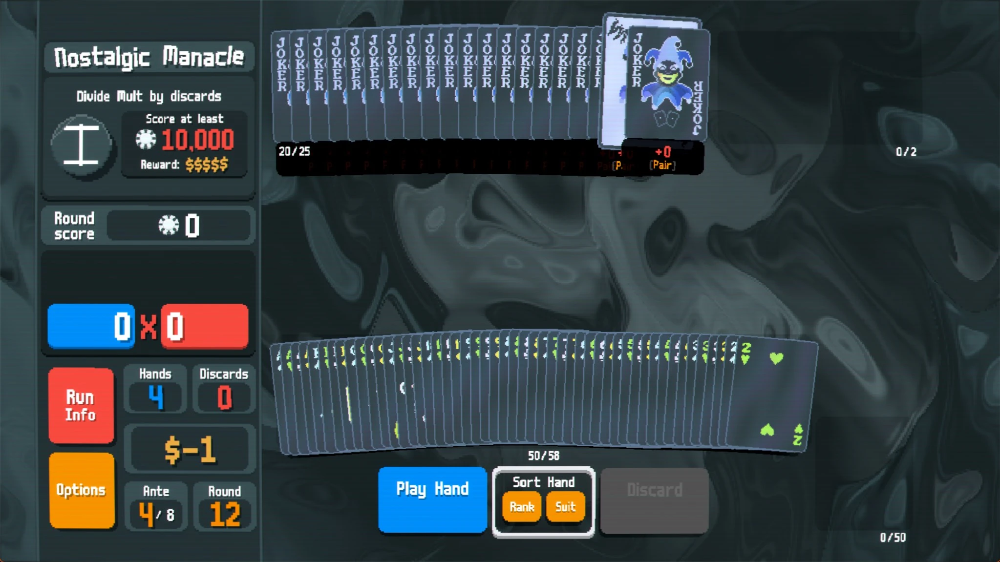
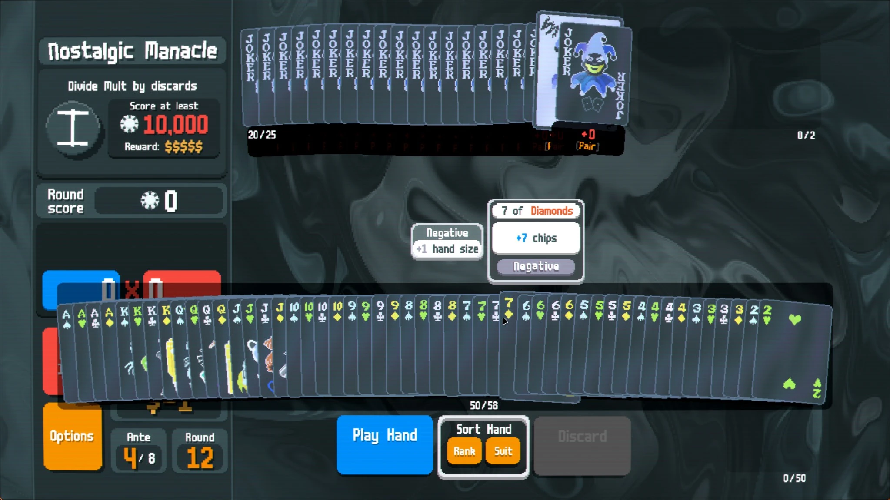
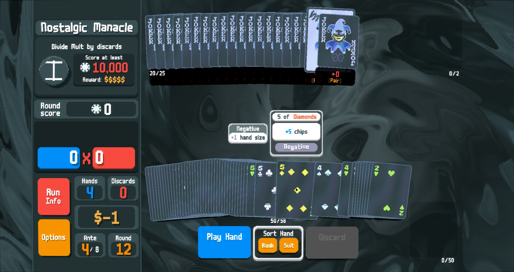
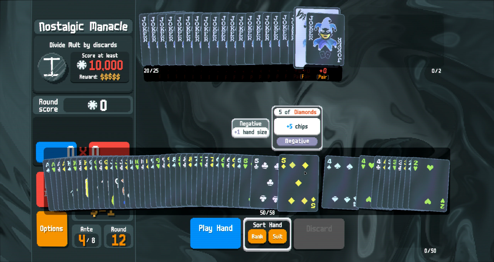
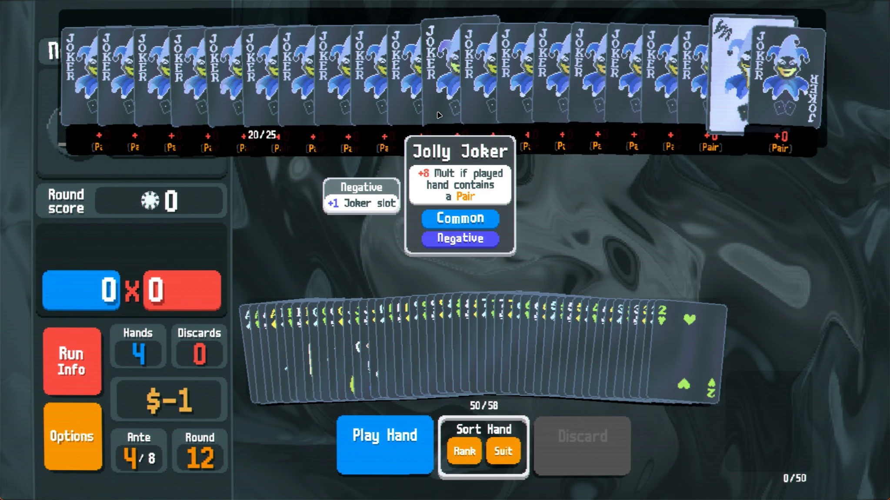
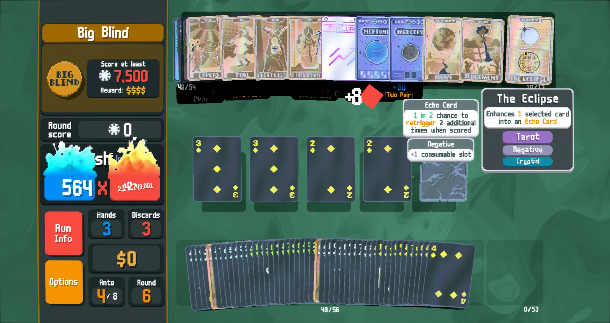
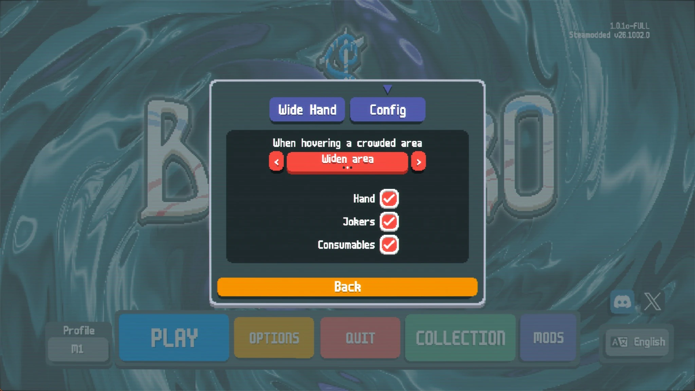

# Wide Hand

A [Balatro](https://www.playbalatro.com/) mod for when you have way too many cards.

When your hand, jokers or consumables are so crowded that the cards overlap into an unreadable pile, hover the area and:

- **Widen** — the area stretches across the screen, drawn on top of the rest of the UI, so every card gets more room.
- **Shift** — cards around the cursor move apart like a magnifier, so the card under the cursor is fully visible.

Move the cursor away and everything slides back. Dragging cards to reorder works against the widened layout.

Nothing changes while the cards still fit normally. The mod only kicks in when cards are spaced less than half a card width apart.

## Screenshots

| Without the mod: 50 cards in hand | Widen area |
|---|---|
|  |  |

| Shift cards | Both (default) |
|---|---|
|  |  |

| Jokers | Consumables |
|---|---|
|  |  |

| Settings |
|---|
|  |

## Settings

**Mods → Wide Hand → Config**

- **When hovering a crowded area:** `Shift cards`, `Widen area` or `Both` (default)
- **Hand / Jokers / Consumables:** choose which areas the mod applies to

Finer tuning (spacing, magnifier strength, backdrop opacity) is in the `WH.cfg` table at the top of `WideHand/main.lua`.

## Installation

Requires [Steamodded](https://github.com/Steamodded/smods) (1.0.0 beta or newer) and [Lovely](https://github.com/ethangreen-dev/lovely-injector).

1. Download `WideHand-vX.Y.Z.zip` from [Releases](../../releases/latest).
2. Extract it into your Mods folder so you get `Mods/WideHand/main.lua`:
   - Windows: `%AppData%\Balatro\Mods`
   - r2modman: `<profile>\mods`
3. Start the game.

Mouse only. The mod is disabled while using a gamepad.

## Releasing

Bump `version` in `WideHand/metadata.json` and push to `main`. GitHub Actions creates tag `v<version>` and a release with the zipped mod. If a release for that version already exists, nothing happens.

## License

[MIT](LICENSE)
